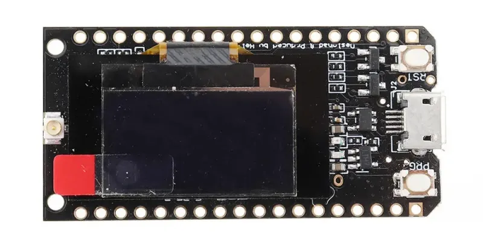

# Board specimen photo checklist

Photographs are evidence for the specific physical specimen shown. A
photograph of one board does not establish that visually similar clones or
other PCB revisions have identical parts, pin mappings, or wiring.

## Specimen 1

The only image currently supplied is one face view. Its orientation as the
manufacturer-designated front or back has not been confirmed. Small component
markings are not legible in this image.

| Requested view | Status |
|---|---|
| Full PCB front | Pending; supplied face not confirmed as front |
| Full PCB back | Pending |
| Printed manufacturer, model, and revision text | Pending readable close-up |
| ESP32 package or module markings | Pending readable close-up |
| LoRa IC/module markings | Pending readable close-up |
| Crystal markings, where visible | Pending readable close-up |
| Antenna connector and frequency label | Pending close-up |
| USB connector and USB-to-UART chip | Pending close-up |
| Wiring modifications | Pending; photograph any modified wiring clearly |

## Photographing additional specimens

Keep each physical board and PCB revision in a separate set. For each
specimen, provide:

- Full, in-focus PCB front and back images.
- Close-ups of printed manufacturer/model/revision text, the ESP32
  package/module, LoRa IC/module, crystal (if visible), antenna connector and
  frequency label, and USB-to-UART chip.
- Clear images of any wiring changes, jumpers, or rework.
- A specimen label in the accompanying notes; do not write over or alter
  board markings.

Only annotate a feature that is clearly visible in the image or has been
confirmed by the board owner. Do not infer chip identity, frequency, pinout,
or PCB revision from a similar-looking board.
